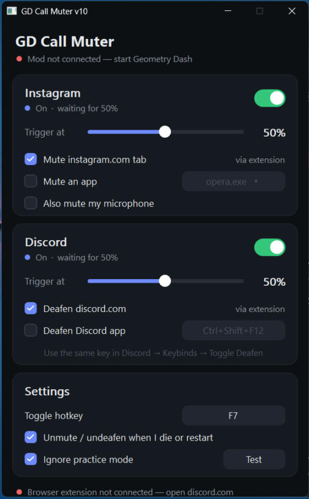
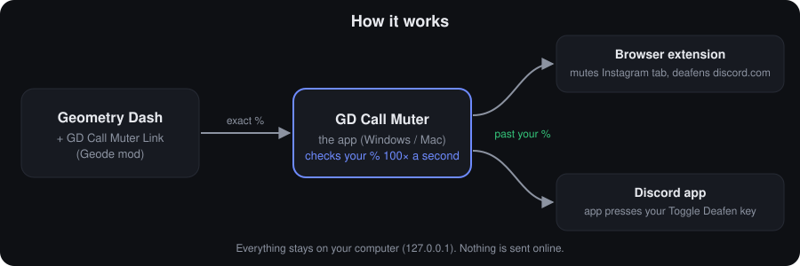
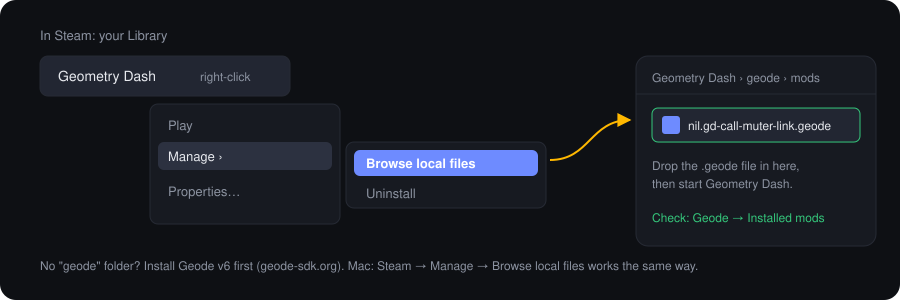
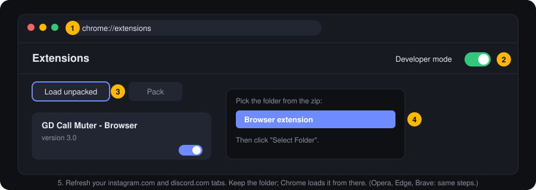
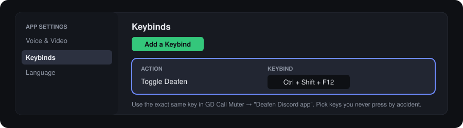
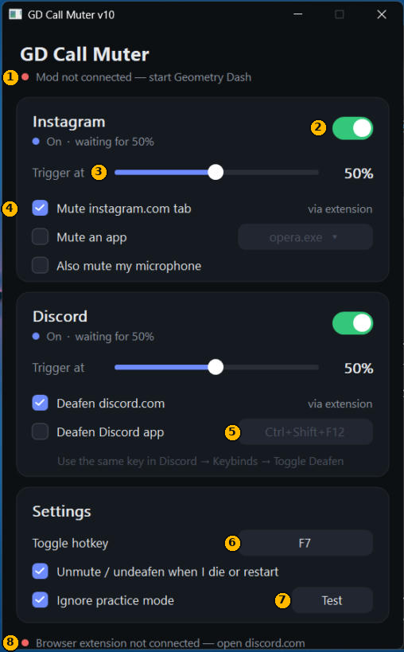
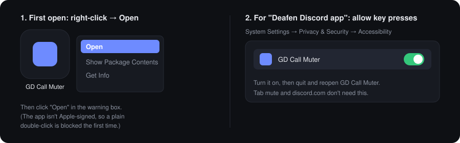

# GD Call Muter

Automatically **mutes your Instagram call** and/or **deafens Discord** when your Geometry Dash run gets past a percentage you pick — and turns it all back on when you die or restart.

---

## Downloads

Get everything from the **[latest release](https://github.com/andrewnguyenpro-pixel/gd-call-muter-link/releases/tag/latest)**:

| You need | Windows | Mac |
| --- | --- | --- |
| **The app** + browser extension | [GD-Call-Muter-Windows.zip](https://github.com/andrewnguyenpro-pixel/gd-call-muter-link/releases/download/latest/GD-Call-Muter-Windows.zip) | [GD-Call-Muter-Mac.zip](https://github.com/andrewnguyenpro-pixel/gd-call-muter-link/releases/download/latest/GD-Call-Muter-Mac.zip) |
| **The Geode mod** (same file for both) | [nil.gd-call-muter-link.geode](https://github.com/andrewnguyenpro-pixel/gd-call-muter-link/releases/download/latest/nil.gd-call-muter-link.geode) | [nil.gd-call-muter-link.geode](https://github.com/andrewnguyenpro-pixel/gd-call-muter-link/releases/download/latest/nil.gd-call-muter-link.geode) |
| Just the exe (no extension) | [GDCallMuter.exe](https://github.com/andrewnguyenpro-pixel/gd-call-muter-link/releases/download/latest/GDCallMuter.exe) | — |

**Requirements:** Geometry Dash **2.2091** with **Geode v6**, and Chrome (or Opera / Edge / Brave) for the browser parts.

---

## How it works

Three small pieces work together. Everything stays on your own computer.

---

## Setup (about 5 minutes)

### Step 1 — Install the Geode mod

1. In Steam, right-click **Geometry Dash** → **Manage** → **Browse local files**.
2. Open the **geode** folder, then **mods**.
3. Drag **`nil.gd-call-muter-link.geode`** into it.
4. Start Geometry Dash. You should see **GD Call Muter Link** under Geode → Installed mods.

### Step 2 — Open the app

- **Windows:** unzip `GD-Call-Muter-Windows.zip` and double-click **`GDCallMuter.exe`**.
  If you see *"Windows protected your PC"*, click **More info → Run anyway** (the app isn't code-signed).
- **Mac:** unzip `GD-Call-Muter-Mac.zip`, then see [Mac extra steps](#mac-extra-steps) for the first open.

The top line of the app turns **green — "Connected"** once Geometry Dash (with the mod) is running.

### Step 3 — Add the browser extension

Needed for muting the **Instagram tab** and deafening **discord.com**.

1. Go to **`chrome://extensions`** in the address bar.
2. Turn on **Developer mode** (top right).
3. Click **Load unpacked**.
4. Pick the **`Browser extension`** folder from the zip, then **Select Folder**.
5. **Refresh** your instagram.com and discord.com tabs.

> Keep that folder where it is — the browser loads the extension from it.
> The bottom line of the app turns **green — "Browser extension connected"** once a discord.com or instagram.com tab is open.

### Step 4 — (Optional) Deafen the Discord *app*

Only if you use the Discord desktop app instead of discord.com.

1. In Discord: **Settings → Keybinds → Add a Keybind**.
2. Action: **Toggle Deafen**. Keybind: something you never press, e.g. **Ctrl + Shift + F12**.
3. In GD Call Muter, tick **Deafen Discord app**, click the key box, and press the **same keys**.

---

## Using the app

| # | What it does |
| --- | --- |
| **1** | **Mod status.** Green = connected; shows your live % in a level. |
| **2** | **On/off switch** for this section. Instagram and Discord are separate. |
| **3** | **Trigger %.** Once your run passes this, the section kicks in. Each section has its own. |
| **4** | **What to mute:** the instagram.com tab, an app's sound (Windows), and/or your microphone. |
| **5** | **Discord app key** — must match your Toggle Deafen keybind in Discord. |
| **6** | **Toggle hotkey** (default **F7**): mute/deafen or undo it by hand, any time. |
| **7** | **Test** — mutes/deafens right now so you can check everything works. Click again to undo. |
| **8** | **Browser extension status.** Green = connected. |

**Settings:**
- **Unmute / undeafen when I die or restart** — on by default, so you hear your call again after each attempt.
- **Ignore practice mode** — practice runs never trigger it.

---

## Mac extra steps

1. **First open:** right-click **GD Call Muter** → **Open** → **Open**. (After that, double-click works.)
2. **For "Deafen Discord app" only:** System Settings → **Privacy & Security → Accessibility** → turn on **GD Call Muter**, then reopen the app.

On Mac, "mute an app" isn't available (macOS has no per-app mute) — use **Mute instagram.com tab** instead.

---

## Troubleshooting

| Problem | Fix |
| --- | --- |
| Top line says **Mod not connected** | Start Geometry Dash. Check GD is **2.2091**, Geode is **v6**, and the mod shows in Geode → Installed mods. |
| Bottom line says **extension not connected** | Open or refresh a discord.com or instagram.com tab. Check the extension is turned on in `chrome://extensions`. |
| *"Already running"* message | Close the other copy of GD Call Muter (including old v9) and open it again. |
| Instagram tab doesn't mute | Make sure the call is in an **instagram.com tab** in the same browser that has the extension, and refresh that tab. |
| Discord app doesn't deafen | The key in the app must exactly match Discord's **Toggle Deafen** keybind. On Mac, allow Accessibility (see above). |
| Deafen gets **out of sync** | The Discord app key *toggles*, so pressing it yourself in between flips it. Press it once more to fix. |
| Mutes during practice | Turn on **Ignore practice mode**. |

---

<b>For developers</b>

| Folder | What's in it |
| --- | --- |
| `src/` | Geode mod (C++). Serves `{"inLevel","percent","practice","attempt"}` on `127.0.0.1:47321/state`. |
| `windows-app/` | Windows app (Go, no outside libraries). Hand-drawn dark UI, Windows Core Audio muting. |
| `mac-app/` | Mac app (SwiftUI). `build.sh` makes a universal `.app`. |
| `extension/` | Browser extension. Long-polls the app on `127.0.0.1:47322/wait`. |

Every push to `main` builds all of it on GitHub Actions (mod for Windows + Mac, both apps) and updates the [latest release](https://github.com/andrewnguyenpro-pixel/gd-call-muter-link/releases/tag/latest).

